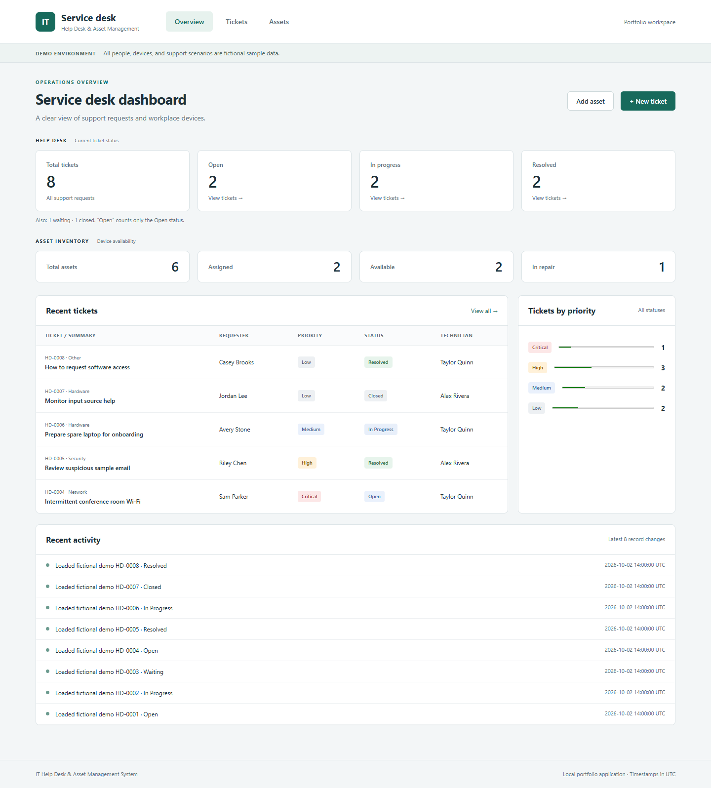
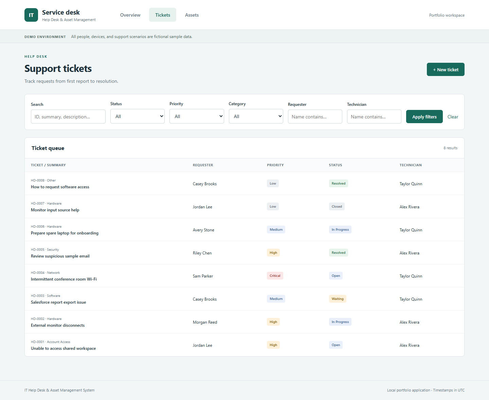
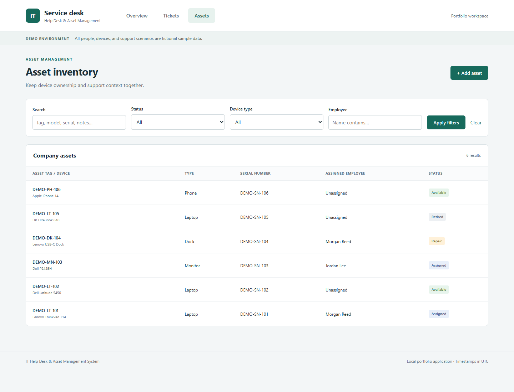
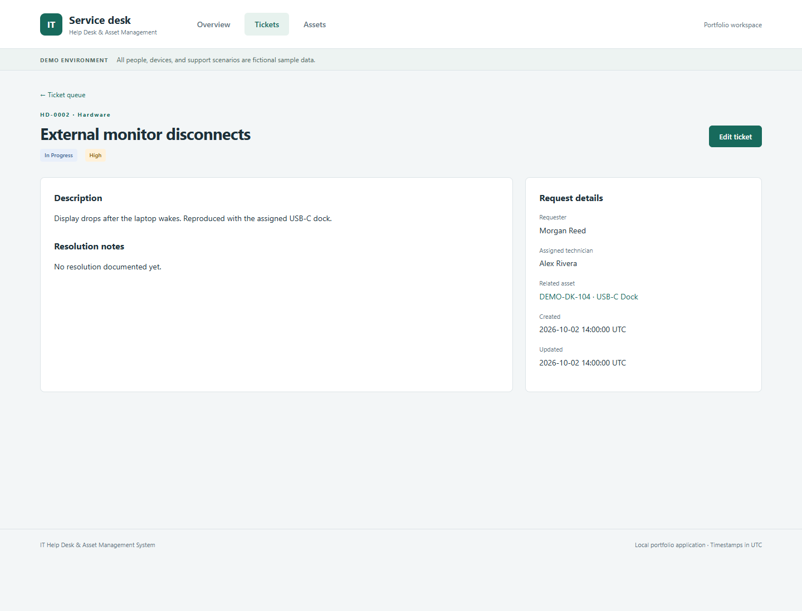

# IT Help Desk & Asset Management System

A practical Flask application for tracking support requests, managing workplace devices, and connecting the two. Built as a focused computer science portfolio project with a real SQLite database, server-rendered forms, and automated workflow tests.

> **Fictional demo only.** Every seeded person, device, serial number, and support scenario is invented. No Big Impact Tech employee, customer, device, credential, or confidential company information is used. Salesforce appears only in a fictional ticket; there is no Salesforce integration.



## Why I built it

As a George Mason University Computer Science student with hands-on experience assisting with user accounts, access issues, workplace devices, Salesforce, and basic IT support at a federal IT government contractor, I wanted a project that connects support operations with software development. This independent application models how a technician can document a problem, track ownership, connect a device, and record a resolution. It does not reproduce an employer's internal systems.

## Features

- **Help desk:** create and edit tickets; generated `HD-0001` style IDs; requester, category, priority, description, technician, status, resolution notes, and UTC timestamps.
- **Ticket search:** search ID, summary, description, requester, or technician; combine status, priority, category, requester, and technician filters.
- **Asset inventory:** create and edit devices with unique asset tags, optional unique serial numbers, manufacturer/model, employee, status, purchase date, assignment date, and notes.
- **Asset search:** search tag, manufacturer, model, serial number, employee, or notes; filter by status, device type, and employee.
- **Connected records:** optionally link a ticket to one asset; navigate between a ticket and its asset, and view all tickets related to a device.
- **Dashboard:** ticket and asset totals, status counts, priority distribution, the five most recently created tickets, and eight most recent record activities.
- **Usable forms:** server validation, field length limits, helpful errors that preserve input, and clear empty states.
- **Simple interface:** responsive local CSS, accessible labels, keyboard focus indicators, and no JavaScript or external CDN required.

## Technology

| Layer | Choice |
| --- | --- |
| Language | Python 3.12 (tested) |
| Web framework | Flask 3.1.2 |
| Database | SQLite through Python's built-in `sqlite3` |
| Templates | Jinja, HTML, and CSS |
| Tests | Python `unittest`, Flask test client, temporary SQLite databases |
| Version control | Git; ready to push to GitHub |

Flask is the only direct third-party runtime dependency. No ORM, Node build, JavaScript framework, Docker, or cloud service is needed.

## Installation and run

Install Python 3.12+ and Git, then open a terminal in this project directory. If cloning from GitHub, clone your repository and enter its directory first.

### Windows PowerShell

```powershell
py -m venv .venv
.\.venv\Scripts\python.exe -m pip install -r requirements.txt
.\.venv\Scripts\python.exe -m flask --app app init-db
.\.venv\Scripts\python.exe -m flask --app app seed-demo
.\.venv\Scripts\python.exe app.py
```

### macOS / Linux

```bash
python3 -m venv .venv
.venv/bin/python -m pip install -r requirements.txt
.venv/bin/python -m flask --app app init-db
.venv/bin/python -m flask --app app seed-demo
.venv/bin/python app.py
```

Open **http://127.0.0.1:5057**. Stop with `Ctrl+C`. On later runs, only the final command is needed. Port 5057 avoids a port conflict encountered during development; override it with the `PORT` environment variable if necessary.

The database is created at `instance/helpdesk.sqlite`. `init-db` preserves existing records; `seed-demo` refuses to run when either the tickets or assets table contains data. To start without examples, omit `seed-demo`. To reset a disposable demo, stop the server and move the database file to a backup location, then repeat initialization and seeding. Schema initialization is not a migration system.

`SECRET_KEY` is optional for this local demo. If unset, a random key is generated at startup, so restarting expires form sessions. Reload an old form if it reports an expired token. For a stable local session key, set `SECRET_KEY` in your shell; do not commit it. `.env` files are ignored but are **not automatically loaded**.

## Two-minute demonstration

1. Open the dashboard: the seed contains **8 tickets** and **6 assets**.
2. Filter tickets to **In Progress + High** and open **External monitor disconnects**.
3. Follow its linked **DEMO-DK-104** asset and inspect the related support ticket.
4. Add a fictional asset as Available. Edit it to Assigned, entering an employee and assignment date.
5. Create a ticket linked to that asset. Update it to In Progress, then Resolved with a meaningful resolution note.
6. Return to the overview and confirm the changed counts and activity entries.

Initial ticket counts: Open 2, In Progress 2, Waiting 1, Resolved 2, Closed 1. Initial asset counts: Assigned 2, Available 2, Repair 1, Retired 1. Priority totals: Critical 1, High 3, Medium 2, Low 2.

## Screenshots

These are actual browser captures of the fictional seeded application.

| Ticket queue | Asset inventory |
| --- | --- |
|  |  |



## Project structure

```text
it-helpdesk/
├── app.py                   # App factory, routes, validation, queries
├── db.py                    # Request-scoped connection lifecycle
├── schema.sql               # Tables, constraints, and indexes
├── seed.py                  # Fictional sample data
├── requirements.txt
├── .gitignore
├── templates/               # Base layout, forms, lists, detail views
├── static/                  # Stylesheet and favicon
├── tests/test_app.py        # Automated integration tests
├── docs/
│   ├── INTERVIEW_GUIDE.md
│   ├── TESTING.md
│   └── screenshots/
└── instance/                # Local database; ignored by Git
```

## How it works

Flask maps URL patterns to Python functions. A GET request queries SQLite and renders a Jinja template. A form POST is validated, written inside a transaction, and redirected to the saved detail page (Post/Redirect/Get). Failed validation returns the form with status 422 and the submitted values.

The `assets` and `tickets` tables have integer primary keys. `tickets.asset_id` is a nullable foreign key to `assets.id`: a ticket has zero or one related asset, while an asset can have many tickets. Foreign-key enforcement is enabled on every connection. The `activity` table stores a small change summary, not a complete audit trail.

Filters use URL query parameters and combine with SQL `AND`. Search matches any searchable column with `OR`. Query values are bound using `?` placeholders; table/column identifiers come only from internal allowlists. `%`, `_`, and backslashes are escaped so a user's search behaves as a literal substring. SQLite's default `LIKE` comparison is case-insensitive for ASCII, not comprehensive Unicode case folding.

Dashboard counts come directly from `COUNT(*)` grouped by status or priority. “Open” means exactly the Open status; Resolved excludes Closed. Priority counts include all statuses. Recent tickets use descending IDs (creation order); activity uses descending activity IDs. All stored change timestamps use UTC.

### Workflow decisions

- Resolved and Closed tickets require resolution notes. Tickets may be reopened; transitions are deliberately flexible.
- Assigned assets require an employee and assignment date. Available/Retired assets must have neither; Repair can retain an assignment.
- Asset tags and nonempty serial numbers are unique case-insensitively under SQLite's ASCII `NOCASE` collation. Blank serial numbers become `NULL`, permitting multiple unknown serials.
- Assignment cannot precede purchase. Future dates are allowed for planned inventory entries.
- A record change and its activity entry commit together. A failed write rolls both back.
- No delete button: retaining ticket and asset context is more useful for this small project. Assets can be retired and tickets closed.

## Testing

```powershell
.\.venv\Scripts\python.exe -m unittest discover -s tests -v
```

On macOS/Linux, use `.venv/bin/python` instead. Tests create temporary databases and do not modify the local demo database.

Eight automated tests cover creation, editing, assignment, linking, resolution, dashboard counts, combined filters, literal search, duplicate identifiers, invalid dates/enums, foreign keys, missing records/pages, seed preservation, form tokens, and HTML escaping. Desktop and mobile browser checks were also performed. See [test results](docs/TESTING.md).

## What I learned

- Translating a support workflow into relational tables and enforceable data rules.
- Separating request handling, database access, presentation, and repeatable sample data.
- Combining flexible SQL filtering with parameterized values and literal wildcard handling.
- Keeping database changes and their activity summaries consistent through transactions.
- Testing complete workflows against isolated databases, including invalid inputs and exact count changes.
- Using browser checks to catch environment issues that a Flask test client cannot reveal, such as another application occupying the intended port.

See [the interview guide](docs/INTERVIEW_GUIDE.md) for a request walkthrough, design tradeoffs, and three concrete technical discussion topics. These notes describe the implementation; review and reproduce the demo before describing personal experience with it.

## Scope and future improvements

This is a local, single-workspace portfolio application, **not an enterprise service desk**. There is no authentication, authorization, real user directory, Salesforce integration, email delivery, file upload, SLA scheduler, full assignment history, or cloud deployment. Anyone who can reach the server can edit records. Flask's development server binds to loopback and debug mode is off; it is not a production server.

Basic measures include parameterized queries, HTML escaping, per-session form tokens, and input validation. These do not constitute a security certification. Concurrent edits currently use last-write-wins, lists are not paginated, and substring searches scan records. The demo banner remains visible even in an empty workspace; use fictional information only.

Reasonable future work: pagination, optimistic edit conflict detection, assignment history, richer test coverage, and schema migrations. Authentication/roles, deployment, and notifications would require a separate scope and review.

## GitHub preparation

The project includes logical commits for schema setup, application features, tests, fixes, and documentation. Dates were not changed. No remote repository was created or pushed.

Git had no configured author identity in the build environment, so the existing commits use the explicit local placeholder **Portfolio Developer <portfolio@example.invalid>**. Set your own name and verified GitHub or GitHub-provided private email for future commits:

```bash
git config user.name "Your Name"
git config user.email "YOUR_GITHUB_EMAIL"
```

Create an empty GitHub repository named `it-helpdesk-asset-management` (without an initial README), then replace `YOUR_USERNAME` below:

```bash
git remote add origin https://github.com/YOUR_USERNAME/it-helpdesk-asset-management.git
git push -u origin main
```

Sign in through Git's normal credential flow if prompted. The `.venv`, local database, and environment files are excluded from Git; recruiters can recreate demo data with `seed-demo`.
